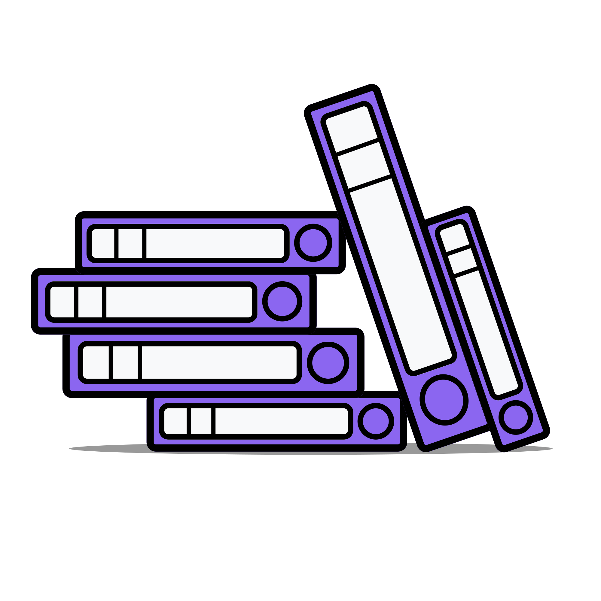
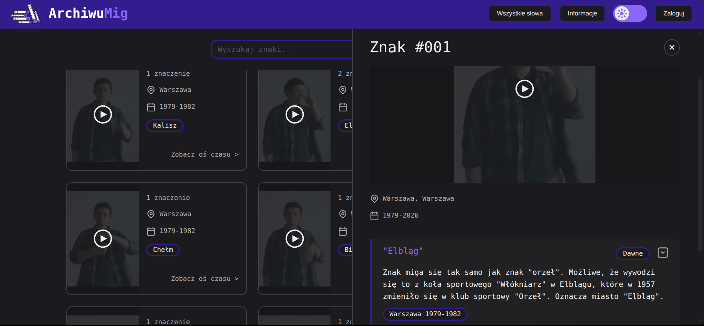
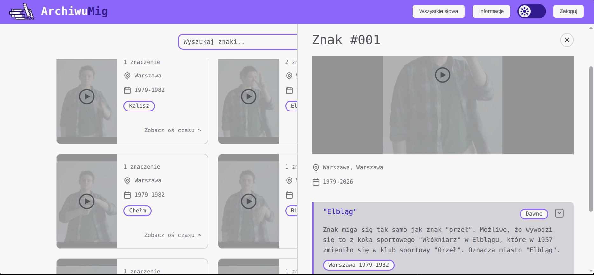
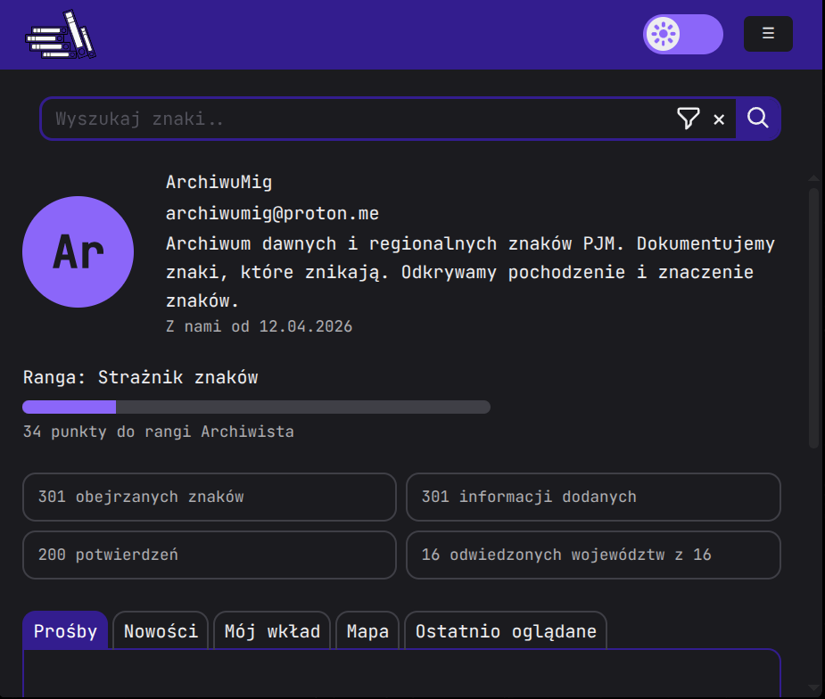
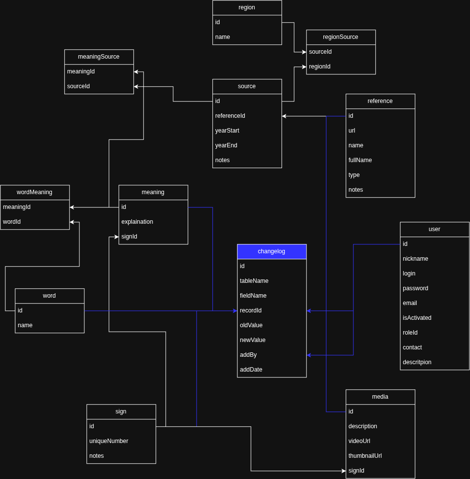

<div id="vscodium-logo" align="center">
   <br />
   
   <h1>ArchiwuMig</h1>
   <h3>Polish Sign Language Archive/Dictionary</h3>
</div>

<div id="badges" align="center">

[](https://archiwumig.pl/)
[](https://github.com/Hoinkas/SignArchive/blob/main/LICENSE.md)
[](https://codeberg.org/Jueltrae/SignArchive/src/branch/Tab-display-and-bulk-movie-download-fixes)


</div>

**Allows user to search, view and manage signs (with media, images or texts), definitions, words ect.**


## Table of Contents
- [Run/Build](#run-build)
- [Database schema](#database-schema)
- [Page view](#page-view)
- [Releases](#releases)
- [About me](#about-me)

## <a id="run-build"></a>Run/Build
First setup and running website. It will install everything in global, frontend and backend folder.

```bash
pnpm install
pnpm dev
```

After that the frontend and backend will run in one terminal. Each message in terminal at the begginign of line will have `[1]` for frontend messages and `[0]` for backend messages. For example:
```bash
[1]   ➜  Local:   http://localhost:5174/ #frontend
[1]   ➜  Network: use --host to expose   #frontend
[0] ◇ injected env (5) from .env         #backend
[0] SignArchive API listening on http://localhost:3000 #backend
```

If there is a need to run frontend or backend separatelly those commands will do. Choose the one you need.
```bash
pnpm dev:frontend
# or
pnpm dev:backend
```

### Signs and sign details view (dark theme)


### Signs and sign details view (light theme)


## Profile view (dark theme)


## <a id="database-schema"></a>Database schema


## <a id="releases"></a>Releases
### Version 1.0 released 17.04.2026
For more info look into wiki.

###  Version 2.0
- [x] Improved screen responsiveness
- [ ] Individual accounts
- [ ] Adding, drafting, editing and deleting items as user
- [ ] Adding, commenting, editing and deleting items as moderator
- [ ] User statistics and ranks
- [ ] Font size adjustment
- [ ] Notifications and following other users
- [ ] Saving signs to your collections
- [ ] Feedback from backend for user's actions (error, success, failure)
- [ ] Signs frequency of use and reliability of the source (did deaf people actually use this sign, or did hearing people created and misused it?)
- [ ] Creating map showing trends and regional variations of specific sign
- [ ] User accounts with moderation and voting on new signs and editing old ones

### Future
- [ ] Add categories to signs
- [ ] Keyboard support
- [ ] Downloading json of a word or/and signs
- [ ] Screen reader compatibility (HTML classes, Arial labels, and focus)
- [ ] Generating video thumbnails with ghost movements from videos
- [ ] Generating files with landmarks from videos
- [ ] Displaying a Three.js motion model moving based on generated landmarks
- [ ] Recognizing a sign from a webcam or video
- [ ] Adding HamNoSys sign transcript
- [ ] Storing multiple videos for a single sign to share with students who want to teach their ML with many media of same word

## <a id="about-me"></a>About me
I am deaf born in hearing family. I’ve been learning PJM (Polish Sign Language) for years, and I’ve been missing a good sign dictionary.

The available PJM dictionaries are often outdated projects from several years ago that don’t indicate whether a sign is still in use or which region it comes from (Warsaw? Kraków? Poznań?).

Also I love etymology and etnography and there is very small information about PJM signs' history and their regional variants.

So I decided to create my own amateur archive/dictionary, which will be updated regularly and to which anyone will be able to add signs, definitions, and sources.
